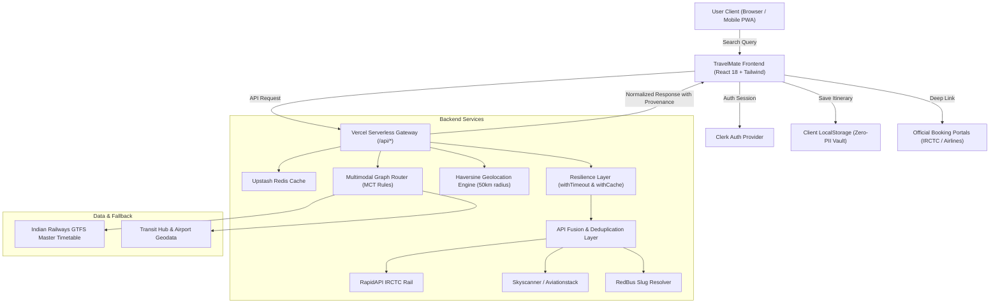
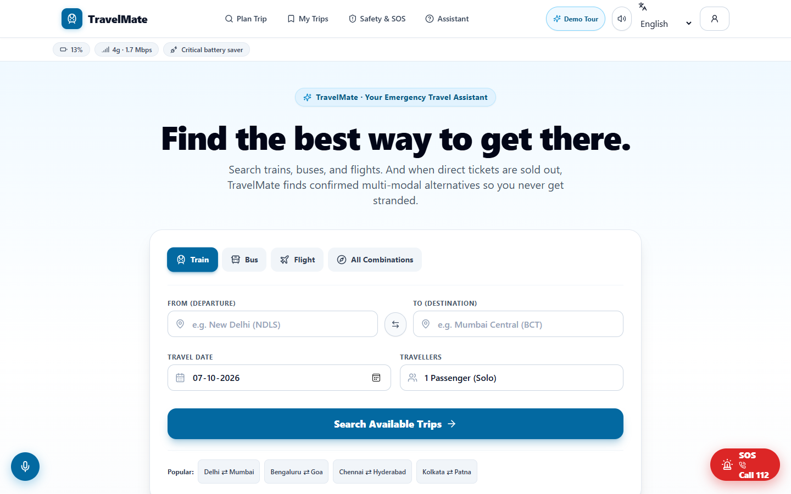
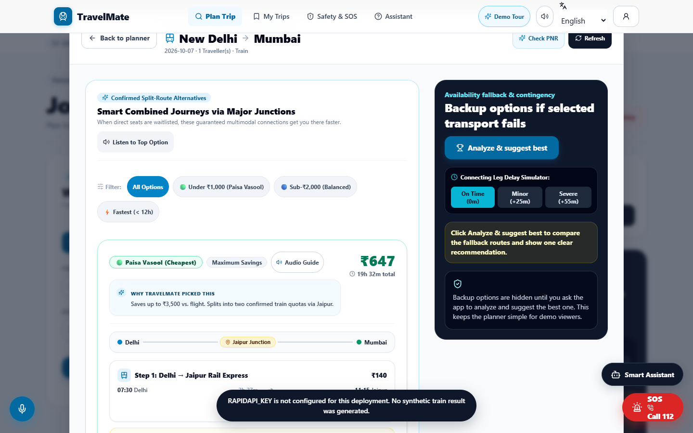
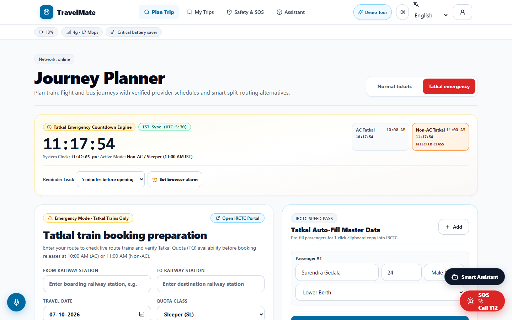
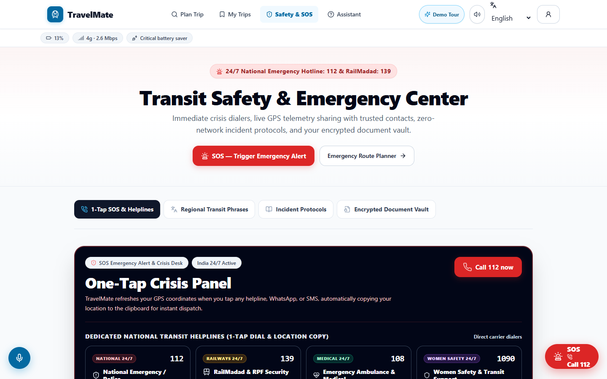
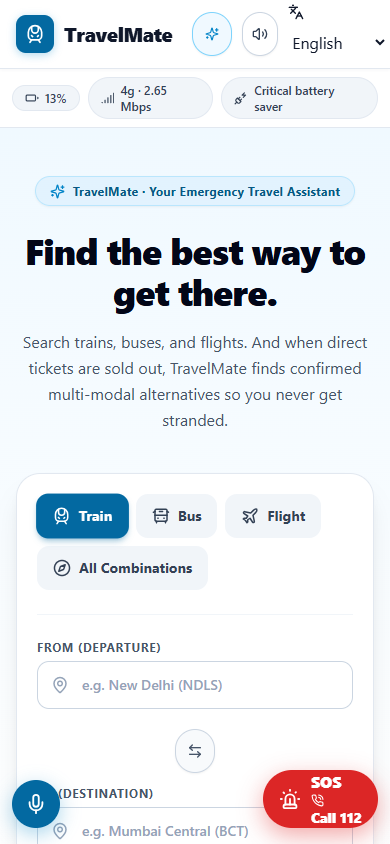

# TravelMate AI

> Autonomous multimodal journey planning and waitlist recovery engine for Indian transit corridors.

[](https://travelmate-ai-flowzint.vercel.app)
[](https://github.com/Surendra900/travell-mate)
[](LICENSE)
[](https://travelmate-ai-flowzint.vercel.app)
[](https://travelmate-ai-flowzint.vercel.app/privacy)

TravelMate AI is an emergency-aware journey planning platform designed to solve travel disruptions across India. When direct train tickets are waitlisted or cancelled, TravelMate synthesizes verified intermodal connections: **Train + Flight**, **Train + Bus**, and **Split-Train connections**, enforcing mathematical transfer buffers so passengers reach their destination on time.

- **Live Web Application:** [https://travelmate-ai-flowzint.vercel.app](https://travelmate-ai-flowzint.vercel.app)
- **Source Repository:** [https://github.com/Surendra900/travell-mate](https://github.com/Surendra900/travell-mate)

---

## Table of Contents

1. [Problem Statement](#1-problem-statement)
2. [Proposed Solution](#2-proposed-solution)
3. [Key Features](#3-key-features)
4. [Technologies Used](#4-technologies-used)
5. [Architecture & Workflow](#5-architecture--workflow)
6. [Installation & Setup](#6-installation--setup)
7. [How to Run](#7-how-to-run)
8. [Application Screenshots](#8-application-screenshots)
9. [Demo Video Link](#9-demo-video-link)
10. [Testing & Verification](#10-testing--verification)
11. [Limitations & Roadmap](#11-limitations--roadmap)
12. [Team Members & Contributions](#12-team-members--contributions)
13. [Third-Party Credits & License](#13-third-party-credits--license)

---

## 1. Problem Statement

Indian Railways transports over 24 million passengers daily across 13,000+ passenger trains. However, track and capacity bottlenecks create severe travel dead-ends:

- **25 Million Cancelled Waitlists Monthly:** Millions of passenger bookings automatically cancel before chart preparation, leaving travelers stranded without travel options.
- **Disconnected Transit Silos:** Railway, civil aviation, and intercity bus operators operate completely independently. A passenger finding WL 80 on a Patna to Bengaluru train is told "No seats available", with no recommendation to take an early feeder train to Kolkata and catch a domestic flight.
- **Costly Connection Failures:** Travelers attempting to piece together connecting flights and trains manually often misjudge city road transfers, missing connections due to traffic delays.
- **Accessibility & Connectivity Deficits:** Critical status updates and offline boarding information remain inaccessible in low-bandwidth rural corridors.

**Concrete Example:** A student travelling from Patna to Bengaluru discovers their direct train is waitlisted at WL 92. Conventional booking portals offer zero alternatives. Emergency direct airfares surge past ₹18,000. TravelMate detects a morning Vande Bharat train from Patna to Kolkata, calculates an airport taxi buffer and domestic check-in margin of 3 hours, and pairs it with an IndiGo flight to Bengaluru for ₹4,800 total, arriving 14 hours faster.

---

## 2. Proposed Solution

TravelMate AI bridges isolated transit modes through an automated graph synthesis engine. When direct bookings are unavailable, the platform dynamically generates verified multimodal itineraries:

1. **Multimodal Graph Routing:** Merges rail timetables, domestic flights, and intercity buses into unified transit paths.
2. **Deterministic Connection Buffers:** Mathematically enforces Minimum Connection Times (MCT) across transfer hubs (e.g. strict 3 hours between rail arrival and domestic flight departure).
3. **Data Provenance Transparency:** Flags each route with clear origin indicators (`LIVE_PROVIDER_DATA`, `TIMETABLE`, `ESTIMATE`) so travelers know whether schedules are live API queries or timetable estimates.
4. **Offline Resilience:** Creates standalone digital boarding passes with QR codes that require zero internet connectivity once generated.

---

## 3. Key Features

### Single-Mode Search with Nearest-Hub Fallback

- **Train Search:** Queries real-time Indian Railways schedules with station code autocomplete.
- **Bus Search:** Aggregates intercity bus schedules across major operators with verified pickup points.
- **Flight Search:** Queries domestic flight options across major commercial carriers.
- **Geospatial Feeder Scan:** Haversine formula scans up to 50 km around selected origins to suggest nearby alternate stations and regional airports when main stations are congested.

### Multimodal Combination Mode

- **Train + Flight Synthesis:** Connects feeder train lines to major aviation hubs.
- **Train + Bus Synthesis:** Pairs high-speed rail corridors with luxury sleeper buses for tier-2/tier-3 destinations.
- **Parametric Delay Contingency:** Real-time delay simulator computes connection risk for 25m and 55m connecting delays, automatically suggesting alternate carriers if a leg is jeopardized.

### Emergency Tatkal Desk

- **Live Countdown Clocks:** Calibrated to Indian Railways booking windows (10:00 AM AC classes, 11:00 AM Non-AC classes).
- **Seat Quota Availability:** Live seat tracking and station-hopper quota bypass suggestions.

### Offline Pass & Safety Hub

- **Zero-Network Boarding Pass:** Generates a lightweight offline ticket featuring PNR, seat, schedule timeline, and QR code stored in local browser memory.
- **Emergency Dispatch:** 1-tap dialer for Railway Helpline 139, National SOS 112, and ambulance 108 with offline GPS coordinate display.
- **DPDP Act 2023 Compliance:** Zero passenger PII stored on backend servers; all passes remain strictly in the traveler's browser storage.

### User Authentication & Modern Interface

- **Clerk Authentication:** Optional sign-in for syncing saved trips across sessions.
- **High-Density Utility Interface:** Clean, distraction-free design with high-contrast text conforming to WCAG 2.1 AA accessibility standards across all 7 routes.

---

## 4. Technologies Used

| Technology                  | Purpose                                                     | Category                 |
| :-------------------------- | :---------------------------------------------------------- | :----------------------- |
| **React 18**                | Component architecture and reactive UI state                | Frontend Framework       |
| **Vite 8 & Rolldown**       | Fast bundling, client code optimization                     | Build Tool               |
| **Tailwind CSS**            | Design token implementation and responsive layout           | UI Styling               |
| **React Router v6**         | Client-side routing across planner, safety, and saved trips | Navigation               |
| **Clerk React**             | User session management and account authentication          | Third-Party Auth Service |
| **RapidAPI IRCTC Rail API** | Live train schedules, PNR status, and seat availability     | Third-Party Transit API  |
| **Skyscanner via RapidAPI** | Domestic flight routes and airfare tracking                 | Third-Party Aviation API |
| **Aviationstack**           | Live flight status validation and airline data              | Third-Party Aviation API |
| **Upstash Redis**           | Serverless rate-limiting and query response caching         | Third-Party Cloud Cache  |
| **SambaNova Systems**       | Meta-Llama-3.3-70B natural language travel assistant        | Third-Party AI Service   |
| **Google Gemini API**       | Natural language route parsing and query understanding      | Third-Party AI Service   |
| **Leaflet & OpenStreetMap** | Interactive route mapping and coordinate visualization      | Maps & Geolocation       |
| **axe-core & Playwright**   | Automated accessibility and end-to-end regression testing   | Testing & Verification   |
| **Vercel**                  | Edge deployment and serverless function hosting             | Cloud Hosting            |

---

## 5. Architecture & Workflow

### Architecture Diagram



### Request Flow

1. **User Search:** Traveler enters origin and destination (e.g. Delhi to Patna) and selects travel date.
2. **Mode Enforcement:** The mode purity engine ensures single-mode queries (train, flight, bus) return only relevant vehicles without cross-pollution.
3. **Parallel API Dispatch:** The API Fusion Layer queries rail and flight providers in parallel through `withTimeout` and `withCache` resilience wrappers.
4. **Feeder Radius Scan:** If direct trains are congested, the Haversine engine locates nearby rail junctions and feeder airports within 50 km.
5. **Connection Buffer Synthesis:** The routing engine evaluates transfer feasibility against Minimum Connection Times (60 min train-to-train, 90 min train-to-bus, 180 min train-to-flight).
6. **Result Presentation:** Itineraries render with individual leg cards, carrier details, transparent data provenance badges, and unbundled direct booking links.

---

## 6. Installation & Setup

### Prerequisites

- **Node.js:** `v20.x` or `>=v22.12.0` (Verified on Node v24.16.0)
- **npm:** `10.x` or higher
- **Git:** Standard git client

### Installation Steps

```bash
# 1. Clone repository
git clone https://github.com/Surendra900/travell-mate.git
cd travell-mate

# 2. Install dependencies cleanly
npm ci

# 3. Create environment file from template
cp .env.example .env.local
```

### Environment Variables Guide

All API keys are optional for running the local mock and timetable explorer. Add keys to enable live provider calls:

| Variable                     | Description                                                         | Source / How to Obtain                             |
| :--------------------------- | :------------------------------------------------------------------ | :------------------------------------------------- |
| `RAPIDAPI_KEY`               | RapidAPI key for IRCTC Rail and Skyscanner flights                  | [rapidapi.com](https://rapidapi.com)               |
| `RAPIDAPI_TRAIN_HOST`        | RapidAPI host for IRCTC (`irctc1.p.rapidapi.com`)                   | RapidAPI IRCTC Endpoint                            |
| `RAPIDAPI_FLIGHT_HOST`       | RapidAPI host for Skyscanner (`skyscanner-flights4.p.rapidapi.com`) | RapidAPI Skyscanner Endpoint                       |
| `SAMBANOVA_API_KEY`          | API key for Llama-3.3-70B travel assistant                          | [sambanova.ai](https://sambanova.ai)               |
| `VITE_GEMINI_API_KEY`        | Google Gemini key for natural language route parsing                | [aistudio.google.com](https://aistudio.google.com) |
| `VITE_CLERK_PUBLISHABLE_KEY` | Clerk key for optional user sign-in                                 | [clerk.com](https://clerk.com)                     |
| `UPSTASH_REDIS_REST_URL`     | Upstash Redis URL for rate limiting and cache                       | [upstash.com](https://upstash.com)                 |
| `UPSTASH_REDIS_REST_TOKEN`   | Upstash Redis token for rate limiting                               | Upstash Dashboard                                  |

---

## 7. How to Run

### Development Server

```bash
npm run dev
```

Starts Vite development server on `http://localhost:5173`.

### Production Build

```bash
npm run build
```

Generates production assets in `dist/` with zero bundle errors.

### Local Production Preview

```bash
npm run preview
```

Serves the compiled production build locally on `http://localhost:4173`.

### Automated Verification & Quality Audit

```bash
npm run audit
```

Verifies IST dates, raw fields, package-lock integrity, and PWA icon definitions.

---

## 8. Application Screenshots

|            Home & Journey Search            |          Multimodal Planner & Availability          |
| :-----------------------------------------: | :-------------------------------------------------: |
|  |  |

|                 Emergency Tatkal Desk                 |         Offline Boarding Pass & Safety Mode         |
| :---------------------------------------------------: | :-------------------------------------------------: |
|  |  |

|            Responsive Mobile View             |
| :-------------------------------------------: |
|  |

---

## 9. Demo Video Links & Presentation Materials

> **BuildX 2026 Hackathon Video Demonstrations**  
> We have provided dedicated placeholders and links below for the evaluation committee.

### Primary Video Pitch (Live Walkthrough & Technical Demonstration)
- 🔗 **Main Video Pitch URL:** [BuildX 2026 Official Video Pitch (Google Drive)](https://drive.google.com/file/d/1TWO1Db1cw3mIHdOxiTsa2AfpixrPiexH/view?usp=sharing)
- ⏱️ **Duration:** ~4–5 minutes
- 🎙️ **Presenters:** Surendra G & Rishitha
- 📝 **Verbatim Demo Script:** [docs/BUILDX_DEMO_SCRIPT.md](docs/BUILDX_DEMO_SCRIPT.md) (Step-by-step narration covering problem, routing engine, and real-time fallback)

### Secondary Video Pitch / Audio Deep-Dive (Alternative / Extended)
- 🔗 **Secondary Pitch URL:** `[Optional: Secondary video pitch / feature deep-dive link]`
- 🎧 **Pre-Calibrated Master Audio:** 4m 20s voiceover track matching the exact demo script timeline.

### Slide Deck (.pptx)
- 📊 **PowerPoint Presentation:** `outputs/TravelMate_BuildX_2026.pptx` (Strict 7-slide deck compliant with BuildX evaluation criteria).
- 📄 **Deck Brief & Evidence:** [docs/PPT_BRIEF.md](docs/PPT_BRIEF.md).

---

## 10. Testing & Verification

TravelMate is backed by an automated test suite verifying routing calculations, accessibility compliance, security headers, and data provenance:

### Running the Test Suite

```bash
# Run unit, integration, and security tests (323 tests)
npm test

# Run transport upgrade tests (136 tests)
node --test tests/transport-upgrade/*.test.mjs

# Run full project validation suite
npm run check
```

### Empirical Test Results Summary

- **Unit & Integration Suite (`tests/*.test.mjs`):** 323 passing, 0 failed.
- **Transport Suite (`tests/transport-upgrade/*.test.mjs`):** 136 passing, 0 failed.
- **Total Assertions Passing:** **459 passing, 0 failed**.
- **Axe-core Accessibility Violations:** **0 color-contrast and WCAG 2.1 AA violations** across all 7 routes (`/home`, `/planner`, `/safety`, `/saved`, `/privacy`, `/terms`, `/disclaimer`).
- **Security Check:** Zero API secrets in client bundles; strict Content Security Policy (CSP) and HSTS enforced in `vercel.json`.

---

## 11. Limitations & Roadmap

### Current Prototype Limitations

- **Unbundled Booking Model:** TravelMate is a search, routing, and recovery discovery engine. It does not sell tickets directly, process credit cards, or issue real IRCTC PNR numbers. Travelers complete booking on official partner portals via deep links.
- **Third-Party API Rate Limits:** Live provider queries depend on free/developer tier RapidAPI subscriptions. When API quotas are exceeded, the platform seamlessly falls back to local GTFS timetable schedules.
- **Intercity Bus Coverage:** Direct bus availability is currently focused on state RTCs and major private operators on high-density corridors.

### Roadmap

- [ ] Direct IRCTC Partner API integration for 1-click in-app Tatkal booking.
- [ ] Real-time flight departure delays mapped directly to live airport taxi transit times.
- [ ] Metro feeder routing for Delhi, Mumbai, Bengaluru, and Chennai junctions.

---

## 12. Team Members & Contributions

- **Surendra G** (Team Lead & Full-Stack Architect) — GitHub: [`@Surendra900`](https://github.com/Surendra900)
  - Designed multimodal graph routing heuristics, Minimum Connection Time (MCT) safety margins, and delay risk simulator.
  - Implemented serverless API fusion layer with Upstash Redis caching and resilience wrappers (`withTimeout`, `withCache`).
  - Executed complete high-density utility UI redesign matching flat ConfirmTkt and redBus design standards.
  - Built comprehensive automated verification suite (459 tests across transport, security, a11y, and integration).
  - Configured CI/CD pipeline, Vercel cloud deployment, and DPDP Act 2023 client-side privacy architecture.

- **Rishitha** (Co-Developer & Frontend / UI-UX Lead)
  - Designed accessible and responsive user interfaces conforming to WCAG 2.1 AA standards across mobile, tablet, and desktop viewports.
  - Developed and styled multimodal timeline cards, station autocomplete combobox, and offline traveler pass generator.
  - Conducted end-to-end user experience audits and usability testing for high-density transit results.
  - Collaborated on hackathon pitch presentation, product architecture documentation, and demonstration workflows.

---

## 13. Third-Party Credits & License

### Third-Party Data & API Credits

- **Indian Railways Schedule Data:** DataMeet Open Data Project and official NTES public timetables.
- **Airport Coordinates & IATA Codes:** MWGG Airports open dataset.
- **Icons:** Lucide React contributors.
- **Mapping:** OpenStreetMap contributors and Leaflet.js.

### AI Tooling Usage Disclosure

In accordance with BuildX 2026 hackathon guidelines:

- Generative AI tools (Anthropic Claude and Google Gemini) were utilized as developer productivity assistants for boilerplate scaffolding, test assertions, and localization dictionaries.
- All routing algorithms, connection buffer formulas, data provenance policies, and final code implementations were designed and verified by the team.

### License

This project is open-source under the terms of the **[MIT License](LICENSE)**.
